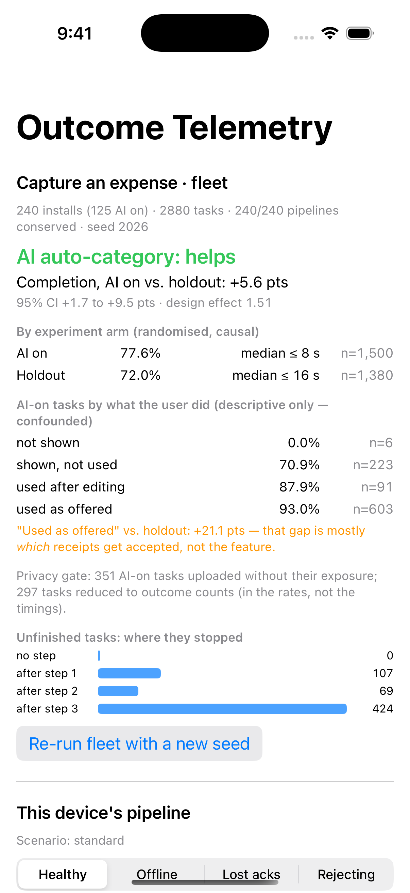
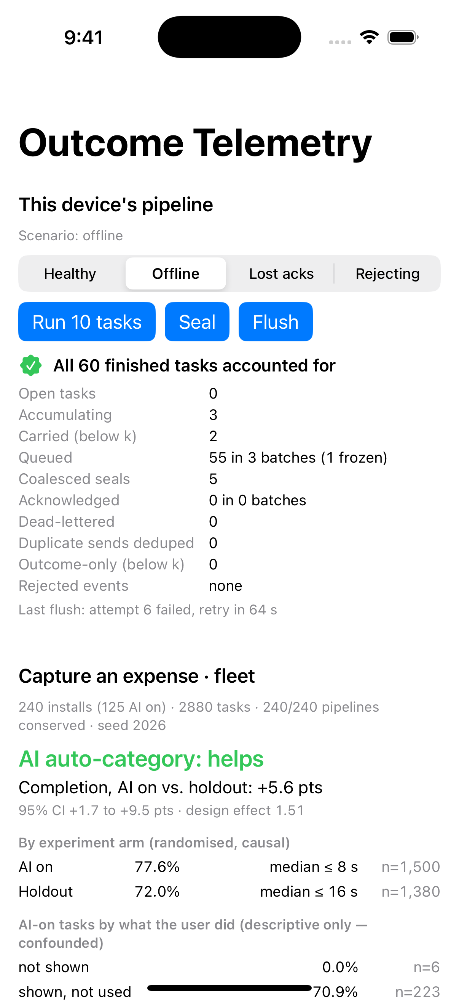

# OutcomeTelemetry Demo

**Does your AI feature make people finish more tasks? This app answers that for a simulated fleet of 240 installs, and shows the wrong answer right next to it.**

It is a SwiftUI iOS app that depends on [**OutcomeTelemetry**](https://github.com/rajatslakhina/outcome-telemetry-kit) as a remote Swift package. When it launches, it runs 2,880 simulated "capture an expense" tasks through real `OutcomeRecorder`s. That is 240 installs, randomised 50/50 into *AI auto-category on* and *holdout*. Every number on screen comes from what a simulated server received after the privacy gate, the journal and the network had their say. Below the fleet report, you can push one device's pipeline through offline back-pressure, lost acknowledgements and rejections and watch every task stay accounted for.

## Screenshots

These are real captures from an **iPhone Simulator on a GitHub-hosted `macos-15` runner (Xcode 16.4)**, taken by this repo's [Simulator run workflow](.github/workflows/simulator.yml). They were **not** taken on the author's Mac (see [Verification](#verification)).

| Fleet report (default launch) | Offline: back-pressure | Lost acks: deduplicated |
|---|---|---|
|  |  |  |

1. **Fleet report.** Turning the AI feature on raises completion from 72.0% to 77.6%: **+5.6 points, 95% CI +1.7 to +9.5**, with the interval widened by a design effect of 1.51 for per-install randomisation. Tasks where the suggestion was "used as offered" completed 93.0% of the time, which against the holdout is +21.1 points. The app labels that gap as confounded: hard receipts get fewer accepted suggestions *and* get abandoned more often.
2. **Offline (`-scenario offline`).** Sixty tasks finish while the network is down. The queue holds 3 batches. One is frozen because it has already been attempted, so its contents can never change under its idempotency key. Five later seals were coalesced instead of dropped, and the sixth retry is backing off for 64 s. All 60 tasks are still accounted for.
3. **Lost acks (`-scenario lost-acks`).** The server applied the first batch but its acknowledgement was lost three times. The client resent it under the same id, and the server counted it once (3 duplicate sends deduplicated). After recovery, all 12 tasks are acknowledged.

## Why this matters

Most "AI impact" dashboards compare users who used the AI feature with users who didn't. Those groups differ for reasons unrelated to the feature, so the comparison flatters it, here by almost four times. The honest comparison is between randomised arms, with an interval that accounts for tasks from the same person being correlated. Getting there takes real system design: a task model with definite outcomes, monotonic timing, on-device aggregation with a privacy gate that doesn't bias the arms, and an offline upload path that neither drops nor double-counts. This app makes all of that visible on one screen.

## What the app does

- `Demo/DemoApp.swift` owns the **policy**: the experiment (`CohortAssigner`, 50/50, salt `ai-autocategory-2026q4`), the fleet privacy gate (k = 3, no carries) and the device pipeline configuration (batches of 10, a 3-batch queue, 8 attempts, 2–120 s backoff). The library only enforces it.
- `Demo/DemoModel.swift` runs `FleetSimulator` into an `InMemoryCollector` and builds an `OutcomeReport` from what that "server" received, including outcome-only rows and the estimated design effect. It also drives one `OutcomeRecorder` with a `ManualClock`. Device actions are serialised, so overlapping taps can't interleave across awaits.
- `Demo/ContentView.swift` lays out `OutcomeDashboard` and `PipelineHealthView` from `OutcomeTelemetryUI`, a network picker (Healthy / Offline / Lost acks / Rejecting) and **Run 10 tasks / Seal / Flush** buttons. Fault scenarios put the device panel first.

## Design decisions

- **Two repos, one remote dependency.** The library has no app target. This project depends on it through `XCRemoteSwiftPackageReference` at `https://github.com/rajatslakhina/outcome-telemetry-kit.git`, with `upToNextMajorVersion` from `1.0.0`, and commits `Package.resolved` at the `v1.0.0` tag's revision. CI builds with `-disableAutomaticPackageResolution`, so a stale resolved file fails instead of silently re-resolving. *Rejected:* a local path (breaks on clone) and `branch = main` (every build gets whatever `main` is that day).
- **The app owns the policy.** Salt, split, *k* and batch sizes are product decisions, so they live in the app, not in the package's defaults.
- **Deterministic scenarios.** The fleet uses seed 2026 and the device uses a `ManualClock`, so every screenshot is reproducible, and the library test `testReadmeHeadlineNumbers` pins the headline numbers above.
- **Warnings are errors for the app target only.** `SWIFT_TREAT_WARNINGS_AS_ERRORS` is set in the target's build settings. Passing it on the `xcodebuild` command line would also apply to the remote package, which Xcode compiles with `-suppress-warnings`, and the two flags conflict. The package is held to warnings-as-errors by its own CI.

## How to run it

1. `git clone https://github.com/rajatslakhina/outcome-telemetry-kit-demo-app.git`
2. Open `Demo.xcodeproj` in Xcode 16 or later. Xcode resolves `OutcomeTelemetry` 1.0.0 from GitHub.
3. Select the **Demo** scheme and any iPhone Simulator (iOS 17+), then **Build & Run**.
4. Optional: enable `-scenario offline` or `-scenario lost-acks` under *Edit Scheme → Run → Arguments* (both are pre-added, unchecked).

Things to try: switch the network to **Offline** and tap **Run 10 tasks** a few times, then **Healthy** and **Flush**. Or pick **Rejecting**, then **Run 10 tasks**, **Seal** and **Flush**, to see a batch dead-lettered and still counted.

## Verification

What actually happened, stated separately:

- **Builds:** the [CI workflow](.github/workflows/ci.yml) (`macos-15`, Xcode 16.4) resolves the remote package from GitHub (`OutcomeTelemetry @ 1.0.0`), then builds the `Demo` scheme for `generic/platform=iOS Simulator` with the app target's warnings as errors. Its result is on the [Actions tab](https://github.com/rajatslakhina/outcome-telemetry-kit-demo-app/actions).
- **Ran on a Simulator, in CI:** the [Simulator run workflow](.github/workflows/simulator.yml) builds the app, installs it on an iPhone Simulator whose runtime matches the SDK, and launches it three times (default, `offline`, `lost-acks`). After each launch it requires the app's process to be alive with a numeric PID, takes a screenshot and commits it. The three screenshots above come from that run. I inspected each one, and its numbers match a headless Linux run of the same view model.
- **Not run on the author's Mac.** Computer-use access to Xcode and Simulator was granted for this session, but Xcode had unrelated projects open and Simulator already had devices booted. Clicking through someone else's open work was not acceptable, so nothing was clicked or captured, and the access was released. Nobody has tapped through this app by hand; the CI run launches scenarios but does not tap buttons.
- **The library:** see [outcome-telemetry-kit](https://github.com/rajatslakhina/outcome-telemetry-kit): 74 XCTest tests, Linux + macOS + iOS Simulator CI.

## Related

- Library: [rajatslakhina/outcome-telemetry-kit](https://github.com/rajatslakhina/outcome-telemetry-kit) ([v1.0.0](https://github.com/rajatslakhina/outcome-telemetry-kit/releases/tag/v1.0.0))

## License

MIT. See [LICENSE](LICENSE).
